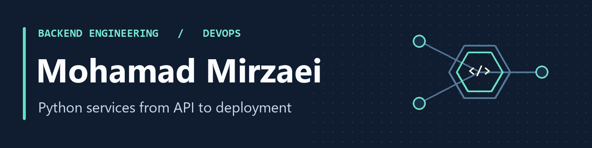

## About me

Hi, I’m Mohamad. At Sobhan Tech I build Python APIs and conversational interfaces, write the tests that exercise them, and maintain the pipelines that ship them. I started my career in DevOps, so I’m especially interested in what happens after a release.

In [SupplyNote](https://github.com/mohamadmirzaei79/SupplyNote), I connect ERP inventory planning with a conversational interface and instrument the path from a buyer’s question to its supporting purchase or sales orders.

Open to remote backend and DevOps roles and freelance projects. [Contact me on LinkedIn](https://www.linkedin.com/in/mohammad-mirzaei-3802b724a).

## Tech stack

| Area | Tools |
| --- | --- |
| **Backend** |    |
| **Delivery** |      |
| **Monitoring** |   |

## Featured projects

### SupplyNote · ERP inventory intelligence

Investigate stock shortages, ask when replenishment will arrive, and inspect the ERP document behind each answer. The local intent classifier and inventory lookup expose per-request traces and server-side Prometheus metrics.

[Try the planning desk](https://mohamadmirzaei79.github.io/SupplyNote/) · [Explore the implementation](https://github.com/mohamadmirzaei79/SupplyNote)

<table>
<tr>
<td width="50%" valign="top">

### [RelayDesk](https://github.com/mohamadmirzaei79/RelayDesk)

**Incident response & shift handoff**

Record a mitigation for **INC-1042** and watch the shift briefing update. The browser demo illustrates the workflow. In the connected edition, FastAPI and PostgreSQL commit each decision and its timeline entry together, with version checks for conflicting edits.

[Try the incident desk ↗](https://mohamadmirzaei79.github.io/RelayDesk/) · [API](https://github.com/mohamadmirzaei79/RelayDesk/blob/main/api.py) · [Integration test](https://github.com/mohamadmirzaei79/RelayDesk/blob/main/test_gateway.mjs)

</td>
<td width="50%" valign="top">

### [ReleaseScope](https://github.com/mohamadmirzaei79/ReleaseScope)

**Deployment performance analysis**

Investigate a sample checkout release where p95 latency climbs from **225 to 374 ms**. The dashboard and FastAPI endpoint share a Python analysis engine that reports which latency or error threshold triggered a review.

[Explore a release ↗](https://mohamadmirzaei79.github.io/ReleaseScope/) · [Analysis code](https://github.com/mohamadmirzaei79/ReleaseScope/blob/main/analysis_core.py) · [Tests](https://github.com/mohamadmirzaei79/ReleaseScope/blob/main/test_analysis.py)

</td>
</tr>
</table>

## Experience

**Sobhan Tech · Python Backend Developer** · Nov 2024 – present  
Build FastAPI services and Chainlit interfaces, maintain unit through end-to-end coverage, and deliver releases with Docker, Helm and Argo CD.

**Mohaymen ICT · DevOps Engineer** · Jun 2022 – Oct 2024  
Containerized applications during a Linux migration, introduced GitOps with GitLab, and monitored Kubernetes workloads using Prometheus and Grafana.

B.Sc. in Electrical Engineering, Isfahan University of Technology · Third place, Iran Open RoboCup junior soccer, 2018.
